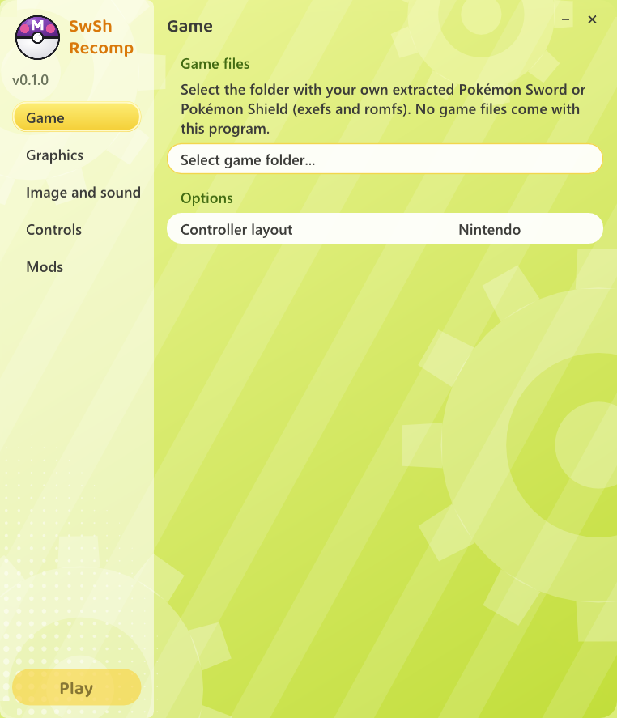
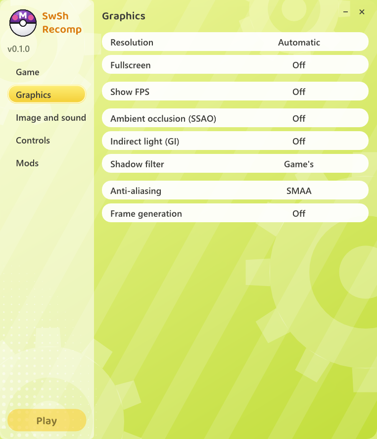
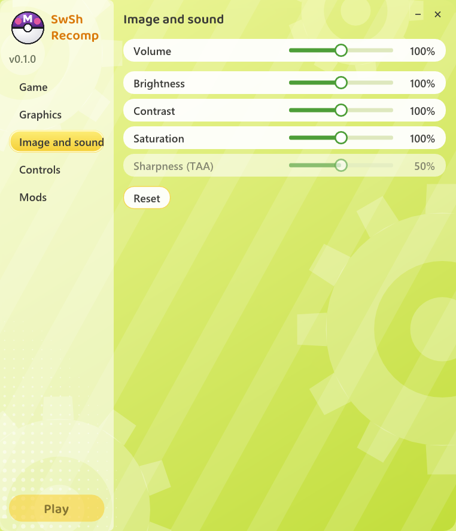
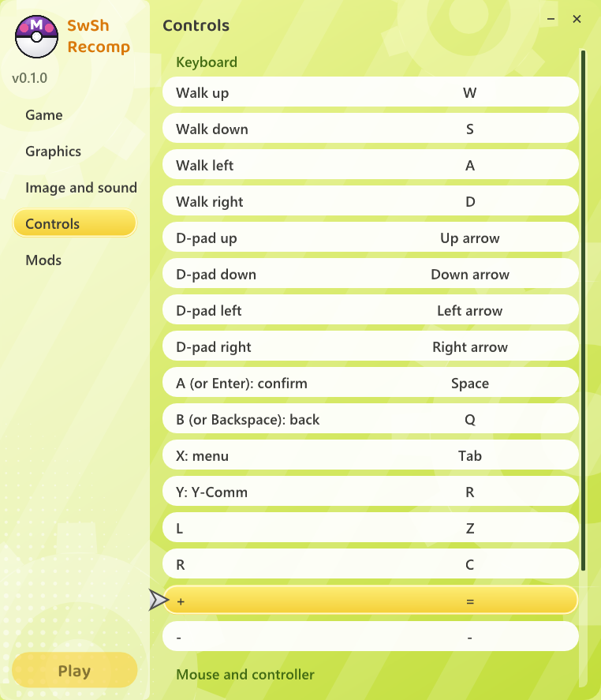
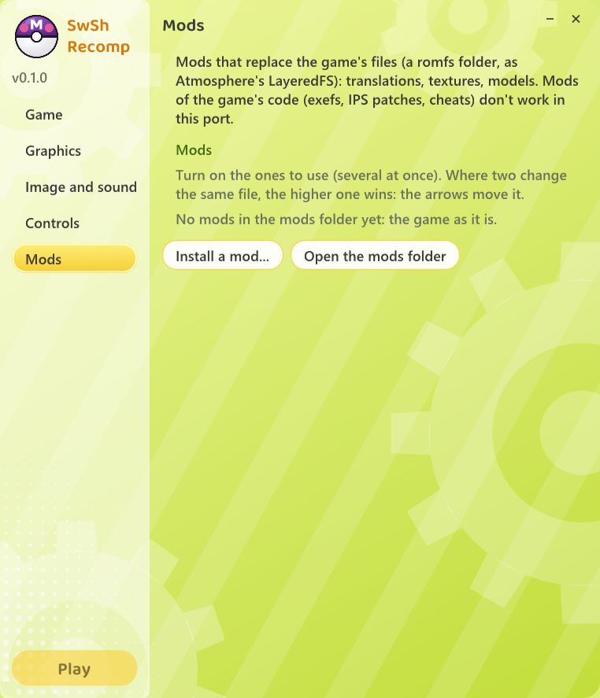

# SwSh Recomp

An experimental native Windows port of **Pokémon Sword** and **Pokémon Shield** (Nintendo Switch), made by **static
recompilation**: the game's ARM64 code is translated into C and compiled for your PC, and a runtime stands in for the
Switch (system services, NVN graphics on Vulkan, audio, controllers). **It is not an emulator.**

It is built on **[Let's Go Recomp](https://github.com/raulzrrs/letsgo-recomp)** (Pokémon: Let's Go, Eevee! / Pikachu!),
which is in turn built on **[LAS Recomp](https://github.com/peiikai/LASRecomp)** by Peiikai.

> [!IMPORTANT]
> **No game files are included, and none ever will be.** You need your own legally obtained copy of *Pokémon Sword*
> or *Pokémon Shield*, extracted (the `exefs` and `romfs` folders). The game code is translated and compiled on your
> own PC from your own dump; nothing from the game is in this repository or in its releases. A fan project, not
> affiliated with Nintendo, The Pokémon Company, Game Freak or Creatures.

> [!NOTE]
> **Tested on Pokémon Sword (v1.0.0) [0100ABF008968000], runs perfectly fine with occasional temporary graphical issues.**
> Pokémon Shield and later versions haven't been tested yet. This is an early port: the work still to do is listed in
> [docs/PORTING-NOTES.md](docs/PORTING-NOTES.md). Bug reports and fixes are very welcome
> ([CONTRIBUTING.md](CONTRIBUTING.md)).
> I do NOT know whether mods work yet - I will test soon.

## What carries over from Let's Go Recomp

- Native code, up to **4K** internal resolution, any window size, fullscreen
- Anti-aliasing **SMAA**, **TAA** or **AMD FSR 3.1**; **FSR 1** for a lower resolution
- Keyboard, mouse and any controller (Nintendo or Xbox layout), every key rebindable
- **Mods**: LayeredFS romfs mods (Atmosphere `contents/<title id>/romfs` packs), several at once
- Shaders cached on disk; the F12 settings menu in game

Let's Go-only features (60 / 120 fps overworld, wild battles, the controller-screen skip, the cutscene camera fix)
hook addresses in Let's Go's executable. They are **switched off and hidden** for Sword / Shield until someone
researches the matching code in these games (see [docs/PORTING-NOTES.md](docs/PORTING-NOTES.md)). Ambient occlusion
and indirect light were tuned on Let's Go's scenes; they are off by default and may look wrong.

## Launcher

You pick your game folder once on the **Game** page; the launcher checks it's Sword or Shield, sets it up and
recompiles it. Graphics, image and sound, controls and mods are set here before playing (the graphics and image
settings are also in the game, on **F12**).

<table>
<tr>
<td></td>
<td></td>
<td></td>
</tr>
<tr>
<td align="center">Game</td>
<td align="center">Graphics</td>
<td align="center">Image and sound</td>
</tr>
<tr>
<td></td>
<td></td>
<td></td>
</tr>
<tr>
<td align="center">Controls</td>
<td align="center">Mods</td>
<td></td>
</tr>
</table>

## Requirements

| | |
|---|---|
| OS | Windows 10 or 11, 64-bit |
| CPU | x86-64 with SSE4.2; AVX2 recommended (the game code is built for older CPUs without it, and runs slower) |
| GPU | Vulkan 1.3 |
| RAM | 16 GB recommended (the one-time setup compiles a large game) |
| Disk | about 30 GB free during setup (the game's data image plus the generated code) |

## Supported games

Tested on Pokemon Sword (v1.0.0), runs perfectly fine with occasional temporary graphical issues.

- *Pokémon Sword* (title id `0100ABF008968000`) and *Pokémon Shield* (`01008DB008C2C000`), any region, from your own
  dump (cartridge or eShop)
- Any version: the base game, or the base game with an update applied when you extracted it (use the merged
  `exefs` + `romfs`). If your extraction tool writes a `control.nacp`, keep it next to `exefs`: the launcher reads the
  game's version from it.
- DLC (*The Isle of Armor*, *The Crown Tundra*) is untested
- `.xci` / `.nsp` files must be extracted first

## How to play

1. Download `SwShRecomp-<version>-windows.zip` from Releases and unzip it into a folder you can write to.
2. Open **`SwShRecomp.exe`** (if Windows warns, **More info** → **Run anyway**).
3. On the **Game** page, click **Select game folder...** and pick the folder with your extracted `exefs` and `romfs`.
4. Wait while it copies the files and recompiles the game for your PC (only once; it can take an hour or more).
5. Click **Play**.

Everything stays in that folder: settings (`larecomp.ini`), saves (`save\`, or `save-shield\` for Shield), mods and
the log (`lasrecomp.log`). For both games, use one folder each.

## Building from source

See [docs/BUILDING-WINDOWS.md](docs/BUILDING-WINDOWS.md).

## Credits

- **[Let's Go Recomp](https://github.com/raulzrrs/letsgo-recomp)** by **raulzrrs** and contributors, including
  **Iván Serrano ([@Vancete](https://github.com/Vancete))**: the runtime, renderer, launcher and tools this port starts from
- **[LAS Recomp](https://github.com/peiikai/LASRecomp)** by **Peiikai**: the recompiler and runtime underneath
- Libraries: SDL 3, FFmpeg (LGPL), Dear ImGui, Vulkan Memory Allocator, shaderc, SMAA, AMD FidelityFX (FSR 1, FSR 3.1),
  bcdec, stb, the Baloo 2 font (OFL), Capstone, Unicorn, PyInstaller, Zig

## License

The code in this repository is under the [MIT license](LICENSE), like Let's Go Recomp and LAS Recomp; third-party
components keep their own licenses. It grants no rights to the games. *Pokémon*, *Pokémon Sword* and *Pokémon Shield*
are trademarks of their respective owners.
